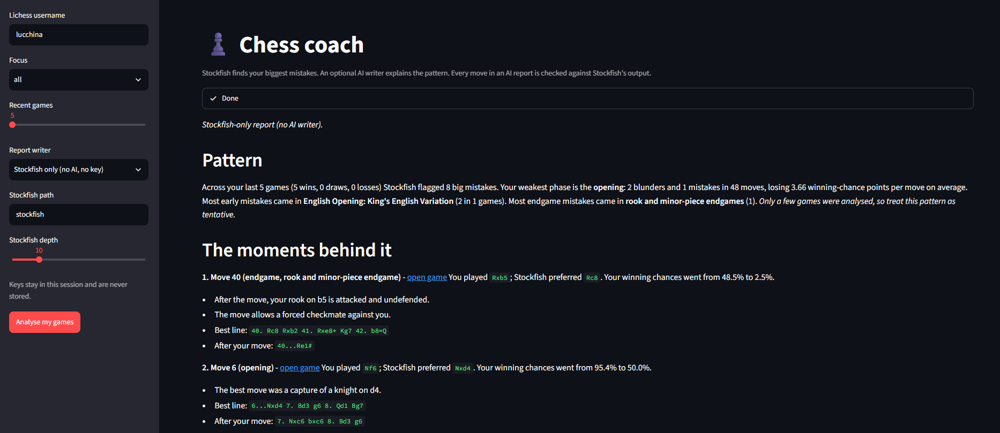
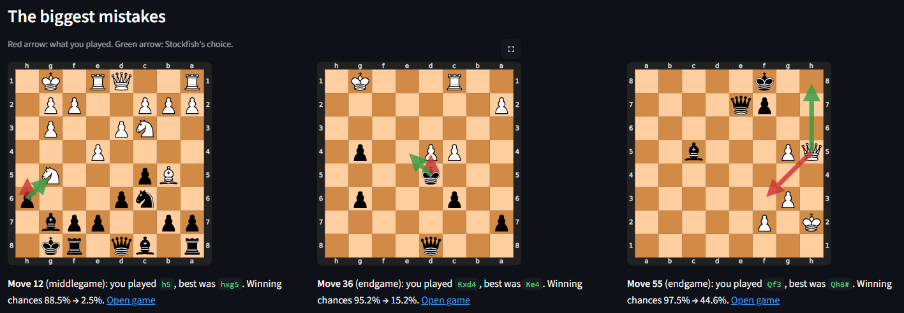
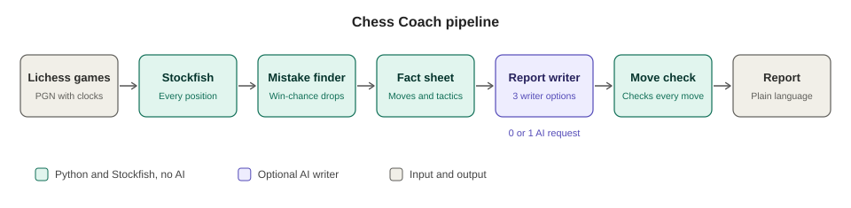
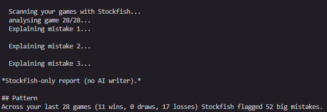

# ♟️ Chess Coach

**Stockfish finds your biggest mistakes. An optional AI writer explains the pattern. The AI never judges a
position, and every move it mentions is checked against Stockfish's output.**

<!-- TODO: replace YOUR_USERNAME and the video link, or delete this line -->
[Live demo](https://huggingface.co/spaces/YOUR_USERNAME/chess-coach)

<p align="center">
  
</p>

## What it does

- Downloads your recent games from Lichess and analyses every move with Stockfish.
- Finds the moves that cost you the most winning chances and sorts them by game phase (opening, middlegame,
  endgame), clock use, opening and endgame type.
- Writes a short coaching report. The writer is your choice: no AI at all, a local model, or Gemini.

## See it in action

<table>
  <tr>
    <td width="50%"><br><sub><b>Biggest mistakes.</b> Red arrow: your move. Green arrow: Stockfish's choice.</sub></td>
  </tr>
</table>

## How the pipeline works

<p align="center">
  
</p>

The orchestration is plain Python, so a report costs **0 or 1 AI requests**. That is what makes it work on a
free API quota or a small local model.

**1. Download games.** The Lichess API returns your recent games with clocks and opening names.

**2. Stockfish analyses every position.** Evaluations are cached on disk, so a second run on the same games
is nearly instant.

<p align="center"></p>

**3. Find the mistakes.** Each evaluation is converted to a win probability. A move that loses 20 or more
points is a mistake, 30 or more a blunder. Moves are tagged by phase, and endgames by type (rook ending, pawn
ending, and so on).

**4. Build a fact sheet.** For the worst moments the code adds Stockfish's best line, the line after your
move, and simple tactical facts (hanging piece, pin, fork, missed capture, mate, material lost). This small
JSON document is everything the writer sees.


**5. Write the report.** Choose a writer:

| Writer | AI requests | Needs | Good for |
|---|---|---|---|
| Stockfish only (`template`) | 0 | nothing | the public demo, always works |
| Local model (`ollama`) | 1, on your machine | [Ollama](https://ollama.com) and a pulled model | private, offline, no quota |
| Gemini (`gemini`) | 1 | `GEMINI_API_KEY` | the best prose |

If an AI writer fails (quota, Ollama not running, an empty reply), the Stockfish-only report is shown instead.

**6. Check the moves.** Every move named in an AI report must appear in the fact sheet. Otherwise the report
is flagged, or rewritten once if you pass `--retry`.

## Quick start

```bash
python -m venv .venv
.venv\Scripts\activate            # Windows   (macOS/Linux: source .venv/bin/activate)
pip install -r requirements.txt
```

**Stockfish.** Download the engine from [stockfishchess.org](https://stockfishchess.org) and point the project
at the executable. It is not bundled with this repo.

```powershell
# Windows, run from the folder that contains the .exe
$env:STOCKFISH_PATH = "\stockfish-windows-x86-64-universal.exe"
Test-Path $env:STOCKFISH_PATH        # should print True
# macOS/Linux: export STOCKFISH_PATH=/usr/games/stockfish
```

The variable only lasts for that terminal window, so start the app or scripts from the same window.

**Run it:** (you can use my username if you just want to test it: **lucchina**)

```bash
python run_pipeline.py YOUR_LICHESS_NAME                          # Stockfish-only report, no AI
python run_pipeline.py YOUR_LICHESS_NAME --backend ollama         # local model (see below)
python run_pipeline.py YOUR_LICHESS_NAME --backend gemini         # needs GEMINI_API_KEY
streamlit run app_pipeline.py                                     # web app with a writer dropdown
```

Useful flags: `--focus opening|endgame|all`, `--games 30`, `--depth 12`, `--retry` (one extra AI request if a
move fails the check).

**Local model:**

```bash
ollama pull llama3.2:3b           # one-time download, about 2 GB
python run_pipeline.py YOUR_LICHESS_NAME --backend ollama
```

A 7-8B model usually writes better but needs more RAM and is slower on a CPU. Pass it with `--model`.

**Gemini:**

```powershell
$env:GEMINI_API_KEY = "paste-your-key"     # get one in Google AI Studio; keep it out of git
python run_pipeline.py YOUR_LICHESS_NAME --backend gemini
```

**Optional puzzle links.** Download `lichess_db_puzzle.csv.zst` from database.lichess.org, decompress it and set
`PUZZLE_CSV` to the `.csv` path. Without it the report skips the practice section.

## Configuration

| Variable | Default | Meaning |
|---|---|---|
| `STOCKFISH_PATH` | `stockfish` | Path to the engine executable |
| `COACH_DEPTH` | `12` | Stockfish depth (higher is slower and more accurate) |
| `COACH_THREADS` | `2` | Engine threads; raise toward your core count |
| `COACH_HASH_MB` | `128` | Engine hash size |
| `COACH_CACHE` | `coach_cache.sqlite` | Evaluation cache file |
| `GEMINI_API_KEY` | | Needed only for the Gemini writer |
| `COACH_MODEL` | `gemini-2.5-flash` | Gemini model name |
| `OLLAMA_MODEL` | `llama3.2:3b` | Local model name |
| `OLLAMA_URL` | `http://localhost:11434` | Ollama server |
| `LICHESS_TOKEN` | | Optional, for higher Lichess rate limits |
| `PUZZLE_CSV` | | Optional, enables practice puzzle links |

Mistake rules live in `coach/config.py`:

- mistake: lose 20 or more win-probability points, blunder: 30 or more
- not flagged if you were already clearly winning (92% or more before, 70% or more after) or already lost (8% or less)
- phases: opening up to move 10; endgame when the combined non-pawn material is 26 or less; otherwise middlegame

Tune these against your own games.

## The agent version (optional)

The repo also has a tool-calling agent: an LLM that decides which tools to run, then writes the report.

| Tool | Input | Returns |
|---|---|---|
| `scan_games` | username, n_games, focus | Mistakes per phase, average loss, clock habits, openings and endgame types linked to mistakes, 10 worst moments |
| `analyze_game` | game_id, focus | Biggest mistakes in one scanned game |
| `explain_position` | fen, played move | Best line, line after your move, win % before and after, tactical facts, puzzle themes |
| `get_practice` | theme, rating | A few Lichess puzzle links near your rating |

```bash
python run_cli.py YOUR_LICHESS_NAME --focus endgame      # agent loop in the terminal
streamlit run app.py                                     # agent loop in the browser
```

The agent makes one LLM request per tool round, roughly 4-7 per report, which is why the pipeline above is the
default: it gives the same report with at most one request.

## Guards against made-up chess

- The prompts forbid judging positions and require every move to come from Stockfish's output.
- `unverified_moves()` in `coach/agent.py` extracts the moves in the final report and checks each against the
  tool or fact-sheet text. Two-character tokens (pawn pushes, plain squares) are skipped because they cannot be
  told apart from squares in ordinary sentences.
- Tool-call caps and backend failures fall back to the Stockfish-only report instead of crashing.

## Tests and what has been verified

```bash
python tests/test_pipeline.py      # facts, template report, fake Ollama server, fallbacks
```

Both use real Stockfish and need no network or API key. They cover blunder detection, phase and endgame
tagging, the tactical facts, the cache, all four tools, the pipeline writers and the move check.

## Limits

- The tactical tags are simple rules and can miss things or over-report. Positional mistakes (pawn structure,
  weak squares) get no named reason, only the evaluation change and the better move.
- Evaluations at low depth can misjudge sharp positions. Only large drops are flagged for that reason.
- Writing quality depends on the model. Small local models write plainer text than Gemini.
- Only public, standard-chess Lichess games are analysed.

## Troubleshooting

| Problem | Fix |
|---|---|
| `Stockfish not found` | Set `STOCKFISH_PATH` to the executable, in the same terminal window you run from |
| Streamlit still says Stockfish not found | Stop it, set the variable, restart it, or paste the full path in the sidebar |
| `model 'llama3.2:3b' not found` | Run `ollama pull llama3.2:3b` (check `ollama list`) |
| `Lichess user not found` | Check the spelling; the account must have public games |
| Lichess rate limit | The downloader waits a minute and retries; use fewer games or set `LICHESS_TOKEN` |
| Gemini quota error | The Stockfish-only report is shown instead; try a lighter model or wait |
| Very slow first run | Lower depth (`COACH_DEPTH=10`) or fewer games; later runs use the cache |
| Report lists unverified moves | The writer used a move that is not in Stockfish's output; rerun with `--retry` |

## Project layout

```
chess_coach/
├── app_pipeline.py        Streamlit app: pipeline with a writer dropdown (the demo)
├── app.py                 Streamlit app: agent loop
├── run_pipeline.py        CLI: pipeline
├── run_cli.py             CLI: agent loop
├── coach/
│   ├── analysis.py        Stockfish wrapper, win probability, phases, tactical facts
│   ├── lichess.py         Game download and parsing
│   ├── tools.py           The four tools and their schemas
│   ├── pipeline.py        Fact gathering and the three report writers
│   ├── agent.py           Tool-calling agent and the move check
│   └── config.py          Settings and thresholds
├── tests/
├── docs/media/            Screenshots, GIFs and the pipeline diagram
└── requirements.txt
```

## Ideas for later

- Progress tracking: compare the last 30 games with the previous 30.
- Endgame tablebase lookups for simple endings (check the current Lichess limits first).
- A "how natural was this move" signal from a model trained on human games.

## Licence and credits

<!-- TODO: add a LICENSE file for your own code and mention it here -->
Built on [python-chess](https://python-chess.readthedocs.io), [Stockfish](https://stockfishchess.org) (GPL,
not bundled here) and the [Lichess](https://lichess.org) API. Not affiliated with Lichess.
